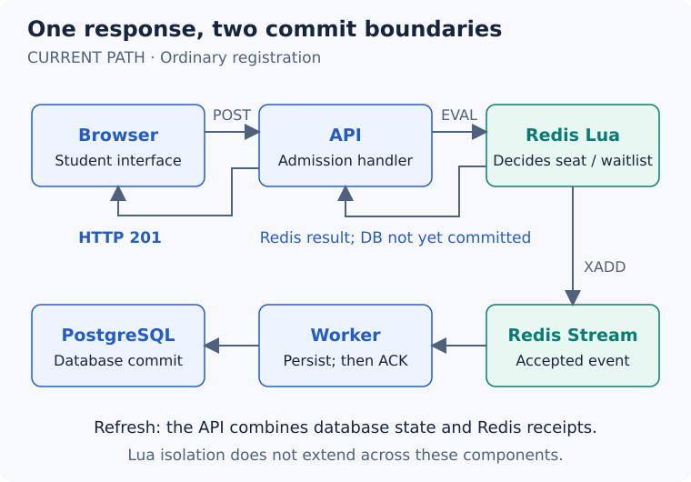
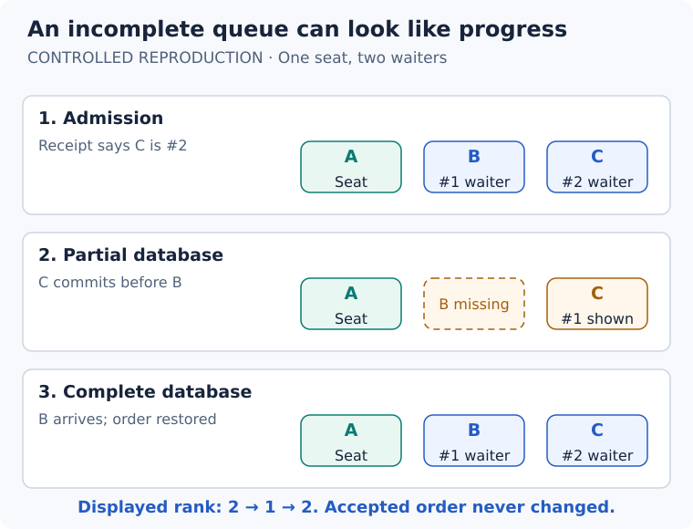
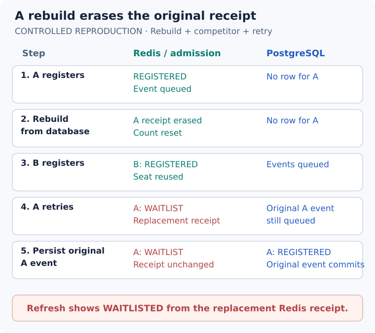
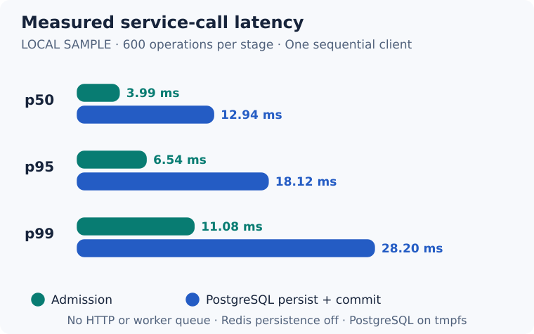
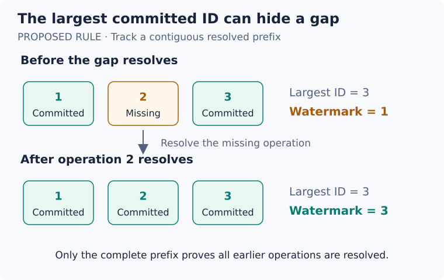
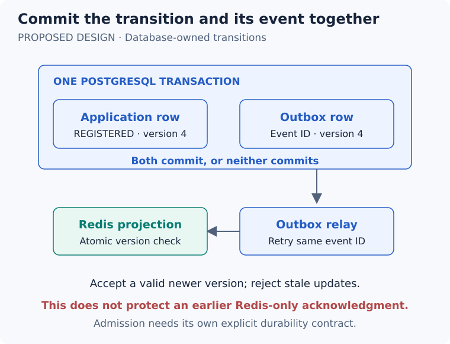
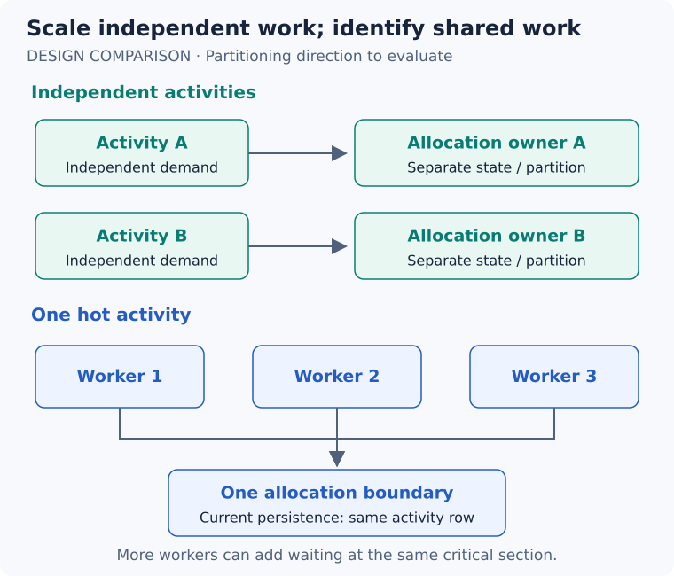

*16 November 2026. Based on the CAMS staging source review and
controlled local experiments. Figures distinguish current behavior from proposed
designs. Proposed changes have not been deployed; this is not a load-test report.*

I build and maintain a campus activity management system for NUIST's
international student community, which serves nearly 1,000 students. That is
community size, not measured concurrent usage. One of its
most interesting problems appears when registration opens for an activity with
limited seats: many people want the same scarce resource at almost the same time.

At first this sounds like a capacity problem. Count the available seats,
allocate one, and put everyone else on a waitlist.

But a student does not experience the counter. They experience a promise on a
screen: “You are registered,” or “You are number 1 on the waitlist.” If refreshing
changes that answer unexpectedly, an implementation detail becomes a question of
trust.

Reviewing this path taught me to ask a more precise question than “Is registration
fast?”: **What has the system actually guaranteed when it displays success?**

## One request, several different moments

The ordinary atomic registration path uses Redis Lua to decide **registered or
waitlisted immediately** and append an event. A background worker later persists
that event in PostgreSQL. The API responds before the database write finishes;
the seat decision does not wait for a later allocation round.



*Figure 1. Current ordinary registration path. The response and the database
commit are separate events. Warm-cache admission can avoid PostgreSQL; cold
starts and some eligibility checks can still require it.*

This separates two moments:

- **Admission:** the allocator decides whether the student is registered or waitlisted.
- **Persistence:** the worker commits its durable database representation.

There are other moments too: the queue view catches up and the browser
refreshes. They do not automatically happen together.

| Moment | What it establishes | What it does not establish |
| --- | --- | --- |
| Admission | Redis has assigned an outcome and returned a receipt | PostgreSQL has committed the application |
| Persistence | The worker has committed a durable database representation | Every earlier accepted request is present in the queue view |
| Projection | A read model represents some set of committed changes | That set covers the cutoff needed to calculate this rank |
| Display | The browser has rendered a response | It rendered the newest authoritative version |

Redis scripts execute without interleaving other clients' commands during the
script. That makes them useful for combining a capacity check with a counter
update. It does not make Redis, PostgreSQL and a browser one transaction.
[Redis's scripting documentation](https://redis.io/docs/latest/develop/programmability/eval-intro/)
defines the scope of that atomic execution.

These are two excerpts from the current `ATOMIC_REGISTRATION_SCRIPT` in
`app/core/lua_scripts.py`. The intervening window checks, outcome selection,
ticket assignment, and payload construction are omitted:

```lua
-- Return the existing receipt on a retry.
local existing = redis.call("HGET", KEYS[2], ARGV[3])
if existing then
    return existing
end

-- ... check the window, allocate, and construct payload ...

redis.call("HSET", KEYS[2], ARGV[3], payload)
redis.call("XADD", KEYS[3], "*", "payload", payload)
return payload
```

The receipt lets a retry return the original outcome. The event carries that
outcome to the worker. Correctness depends on preserving both.

The worker normally preserves the Redis decision. The problem to investigate
is how queue reads, receipt replacement, cache recovery and later transitions
can still make the displayed answer disagree with that decision. A separate
priority-application workflow exists, but it is not the workflow examined here.

## How number 1 can become number 2 without anyone cutting in line

Consider an activity with one seat. A receives that seat. B is the first waiter,
and C is the second.

Now imagine background consumers persist C before B. That is possible even when
events were admitted in the correct order: work can finish in a different order
from the order in which it entered a queue.

The database temporarily contains A and C. If the interface asks the database
for C's position, it sees only one waiter and reports number 1. When B's earlier
request arrives, the database correctly places B first and C second.

The queue order did not change. The first view was incomplete.



*Figure 2. The accepted order stays the same. The partial database view is missing
B. C's displayed path is 2 → 1 → 2.*

I reproduced this locally against the current implementation: C's immediate
receipt said number 2, a detail read briefly said number 1, and a later read said
number 2. This is a controlled reproduction, not a measurement of how often it
happens in production.

The saved observation exercises the real persistence service and detail-read
endpoint with disposable PostgreSQL and FakeRedis. Its essential assertion is
below; setup and the calls that produce the three values are omitted:

```python
assert (
    initial.waitlist_position,
    first["registration_status"].waitlist_position,
    second["registration_status"].waitlist_position,
) == (2, 1, 2)
```

It also shows why a stable ticket and an active rank are different things. If a
previous waiter leaves, subtracting seat capacity from a lifetime ticket counter
still counts that departed person. The ticket remains useful for ordering;
the arithmetic no longer describes the active queue.

A better contract would give the student a stable application identity, then
publish their rank together with its revision and whether the underlying view
is complete enough to treat that rank as settled.

Rank can legitimately improve after a withdrawal. That is different from
presenting an incomplete view as settled.

## How an immediate registration decision can be displayed differently later

I also reproduced a state change on this ordinary path under a specific
cache-recovery and retry sequence. A received `REGISTERED` while its database
write was still queued. Rebuilding the allocation cache from the incomplete
database erased A's receipt. B then received a seat, and A's retry received
`WAITLIST` because its original receipt could no longer deduplicate the request.



*Figure 3. A specific rebuild, competing request, and retry sequence. Refresh
does not itself submit another registration request.*

Even after A's original event persisted as `REGISTERED`, a refresh displayed the
new Redis waitlist receipt. The read path assumed that a differing Redis state
was newer. It had no versioned record of which outcome should win.

This was a controlled local experiment, not proof of a particular production
incident. It required rebuilding allocation state, a competing request and a
retry; traffic alone did not establish the failure. But it makes the engineering
question concrete: how do we preserve an accepted decision through recovery
instead of treating live admission state as disposable cached data?

Metadata reconstructed from PostgreSQL is a cache. An unpersisted receipt may
be the only record of a promise already shown to a student. Rebuilding that
state needs a recovery protocol: fence admission, establish a durable snapshot
cutoff, replay accepted operations after it, restore ordering and terminal
records, and publish the recovered allocation epoch. Preserving existing Redis
hashes alone cannot recover admissions after total Redis loss.

## What the experiments actually measured

The most useful numbers in this review describe correctness under deliberately
chosen event orders. They do not estimate production failure rates.

| Controlled setup | Recorded observation | What it demonstrates |
| --- | --- | --- |
| One seat; A, B, C accepted; C persists before B | C's rank: **2 → 1 → 2** | An incomplete projection can change a displayed position |
| One seat; B leaves before C joins | C's immediate rank: **2**; active database rank: **1** | Lifetime ticket arithmetic counts departed applicants |
| One accepted application; rebuild before persistence; same student retries | Stream entries: **1 → 2** | Losing the receipt allows another event for the same student and activity |
| One seat; A accepted; rebuild; B accepted; A retries | **3 events**; A is `REGISTERED` in PostgreSQL but `WAITLISTED` in the detail response | Recovery and retry can replace a visible decision |
| One seat; A withdraws before persistence; B persists; C joins | **0 occupied seats, 2 active waiters** | Capacity safety alone does not ensure useful allocation |
| Wrong-type stream injected before Lua execution | **1 receipt, 0 stream events** | A command error can leave earlier script writes behind |

The companion review records **50 existing registration checks passing** and
**8 additional observation checks passing**. For the latter, passing means the
limitation was reproduced. These are covered scenarios, not 58 independent
production samples.

The **8 observation checks passed again** during this editorial pass, using a
fresh disposable PostgreSQL container and FakeRedis. The real-Redis command-error
result above is from the earlier independent reproduction. Test-suite duration
includes setup and is not registration latency.

### A small timing sample with real Redis and PostgreSQL

I also measured the two service stages separately on 16 November 2026. This
used real Redis 8.6.1 and PostgreSQL 15.16 in disposable Docker containers, with
Python 3.14.3 calling their loopback ports. Three runs each used 20 warmup
registrations and 200 measured registrations: **600 measured samples per stage**,
one sequential client, and one newly created activity per run.

| Service stage | p50 | p95 | p99 |
| --- | ---: | ---: | ---: |
| Warm-cache `register_atomic` call, including Redis round trips | **3.99 ms** | **6.54 ms** | **11.08 ms** |
| `save_atomic_registration` call, including PostgreSQL commit | **12.94 ms** | **18.12 ms** | **28.20 ms** |



*Timing sample. Pooled nearest-rank percentiles from three runs. These are
separate stage timings; adding their percentiles does not produce an end-to-end
percentile.*

Each run's measured cohort produced 100 `REGISTERED` and 100 `WAITLIST` results.
After including warmup, database assertions checked 120 registration rows and
100 waitlist rows per activity. Setup and warmup were excluded from the timings;
the persistence calls used actual commits, not test savepoints.

The environment exposed four logical CPUs and used Docker Engine 29.2.1.
Redis persistence was disabled, and PostgreSQL data lived on `tmpfs`. The calls
excluded HTTP, authentication, browser work, worker scheduling, stream consumption,
and acknowledgment. A receipt read between stages was also outside both timers.
Consequently, these numbers measure neither disk durability nor the queue delay
a user would experience. They also do not compare this architecture with a
fully synchronous alternative.

The [machine-readable timing results](/assets/files/fast-registration-consistent-promises/timing-results.json)
include the individual run summaries. The [measurement harness](/assets/files/fast-registration-consistent-promises/measure-registration-service.py)
requires the CAMS backend checkout and its test dependencies; it creates and
removes its own containers and never uses the application's database URL.

The sample makes the two stages concrete. It does not establish a maximum
requests-per-second figure or behavior under contention. Production performance
needs the real durability settings, concurrent arrivals, and the complete request
and worker paths.

## Atomicity is only one part of fairness

“Fair” can mean several different things here.

It can mean never allocating more seats than exist. It can mean refusing
duplicate applications. It can mean respecting acceptance order, preserving
institutional priority rules, or ensuring that a seat does not remain empty
while eligible people wait.

These properties need separate definitions and checks.

Even first-come-first-served needs an agreed boundary. The first click on a
student's device is not necessarily the first request to reach the allocator.
Network latency and server scheduling intervene. A server timestamp cannot
remove that uncertainty, and microsecond precision does not establish fairness
between students on different networks.

For one allocator, a monotonic acceptance sequence can define a reproducible
order. A priority policy can then define which groups are compared first. The
policy itself still needs to be explained and justified; an atomic
implementation cannot decide whether that policy is socially fair.

## Sometimes waiting is better—but the wait must mean something

An immediate success message feels responsive. It can also be premature if the
system has not reached the durability boundary that success is supposed to mean.

One design I want to evaluate is a short, bounded wait for the exact operation's
completion. If it commits within that budget, show confirmation. Otherwise,
show “Request received; confirming your place” and continue reconciling the
same operation. The acknowledgment stays fast without inventing certainty.

Waiting an arbitrary two seconds is different. It establishes no fact about the
worker, especially during a backlog or outage. The useful question is “What
condition are we waiting for?”

For the direct path, the condition might be that this registration has committed
and that the queue view includes all earlier accepted requests needed to compute
its rank. That could be tracked with an acceptance sequence and a contiguous
persistence watermark. The system would not need to wait for registration to
close; it would need evidence that the particular view it is showing is complete.



*Figure 4. Proposed completeness tracking. The largest committed sequence is
3 in both snapshots; only a contiguous watermark reveals the gap.*

This executable Python example illustrates the rule. It is an in-memory teaching
example, not a production coordination mechanism:

```python
def advance_watermark(watermark: int, resolved: set[int]) -> int:
    while watermark + 1 in resolved:
        watermark += 1
    return watermark


resolved = {1, 3}
assert advance_watermark(0, resolved) == 1
resolved.add(2)
assert advance_watermark(0, resolved) == 3
```

Here, `resolved` means a durably applied operation or a durably recorded terminal
resolution. A production design needs an epoch-scoped sequence without unexplained
gaps, atomic updates, and a durable record of unresolved operations. Redis Stream
IDs should not simply be treated as consecutive integers. Completeness must
cover relevant withdrawals and promotions too.

A possible response could separate the outcome, its persistence, and the
completeness of its rank:

```json
{
  "operation_id": "application-7f3a",
  "allocation_epoch": 6,
  "application_state": "WAITLISTED",
  "durability": "COMMITTED",
  "application_version": 1,
  "queue_revision": 108,
  "waitlist_position": null,
  "position_is_provisional": true
}
```

This is a proposed API shape, not the current CAMS response. The application is
durable, but its position is still updating. A client should keep the same
operation identity across retries and avoid letting an older response overwrite
a newer version. A timeout means the client lacks an answer; it does not prove
the operation failed. Application versions order one application's transitions;
queue revisions describe the queue view. One cannot replace the other.

If the admission authority already provides the required durability and owns
the active queue, immediate confirmation can remain appropriate. A downstream
database copy need not delay the user just because it is asynchronous. What
matters is a defined authority and a display that follows its decisions.

## Queues move work; they do not remove the need for recovery

Background persistence protects the request path from waiting on every database
write. It also creates failure boundaries that need their own protocols.

A worker might commit and crash before acknowledging its event. The event can
be processed again, so persistence must be idempotent. The current worker
already has duplicate handling and pending-message recovery. Redis's consumer
acknowledgment removes an entry from a group's pending list; it does not itself
delete the event from the stream.
[Redis XACK documentation](https://redis.io/docs/latest/commands/xack/).

Other transitions cross the boundary in the opposite direction. A withdrawal
may commit in PostgreSQL before its cached receipt changes. For these
database-owned transitions, an outbox written in the same transaction could
carry committed, versioned updates to the cache.



*Figure 5. Proposed design for database-owned transitions. Relay retries reuse
the same event identity; version checks reject older cache updates.*

The transaction would have this shape. These table names and columns illustrate
the design; they are not the current CAMS schema:

```sql
BEGIN;

UPDATE applications
SET state = 'REGISTERED', version = 4
WHERE id = 'application-7f3a' AND version = 3;
-- Require exactly one updated row; otherwise abort without an event.

INSERT INTO outbox (event_id, application_id, version, state)
VALUES ('promotion-91b2', 'application-7f3a', 4, 'REGISTERED');

COMMIT;
```

Script isolation also differs from rollback. In an injected wrong-type failure
at the current script's `XADD`, earlier counter and receipt writes remained.
The result was a `REGISTERED` receipt with no persistence event. Checking key types
before mutation helps with this specific failure; the system still needs a way
to detect and resolve missing events. Merely reordering writes changes which
partial state is possible.

That still leaves the original Redis admission to make durable. An outbox
created only when the worker eventually reaches PostgreSQL cannot retroactively
protect an earlier acknowledgment from Redis data loss. Recovery design must
start at the first promise the system makes.

Similarly, a mounted Redis volume is only part of a durability plan. Persistence
settings, replication, eviction, replay and restore behavior need an explicit
failure model.
[Redis's persistence guide](https://redis.io/docs/latest/operate/oss_and_stack/management/persistence/)
describes the different persistence choices and their trade-offs.

## What changes at a million users?

A million accounts are not the same as a million simultaneous requests. A
million requests spread across independent activities are also different from
a million people competing for one activity.

Docker already helps me package the API and worker separately and reproduce
the environment. Kubernetes could help schedule replicas, recover failed
processes and scale supported workloads. Those tools manage execution capacity;
the application still owns its allocation rules and commit boundaries.

Autoscaling also reacts through a control loop. For a registration opening whose
time is known in advance, preparing capacity before the burst may matter more
than reacting after it begins.
[Kubernetes HPA documentation](https://kubernetes.io/docs/concepts/workloads/autoscaling/horizontal-pod-autoscale/).

More workers can process independent activities concurrently. But if every
worker locks the same activity row, they still share that activity's serial
critical section. More processes can mean more waiting connections rather
than more useful throughput.



*Figure 6. A partitioning direction to evaluate, not the current deployment.
Parallel workers do not eliminate coordination over one scarce resource.*

Partitioning introduces another design constraint. The current allocation
script touches several activity keys and a global event stream. Redis Cluster
requires the keys used by a multi-key operation to share a hash slot. Grouping
activity keys with a common hash tag helps, but the stream must fit the same
partitioning plan too.

For example, this proposed layout colocates both activity state and its stream
under the same `{42}` hash tag:

```text
activity:{42}:count
activity:{42}:participants
activity:{42}:ticket_seq
activity:{42}:events
```

A global stream outside that slot would leave the script incompatible with
this layout. Local streams also change consumer discovery, replay, and recovery;
changing key names alone is not a cluster migration.
[Redis Cluster specification](https://redis.io/docs/latest/operate/oss_and_stack/reference/cluster-spec/).

One hot activity remains a shared resource even after independent activities are
distributed. A sequencer, a replicated log or disjoint seat quotas are possible
directions to study. Each changes the balance between coordination, latency,
availability, utilization and fairness.

Distribution makes some workloads feasible. It also adds delayed messages,
duplicate delivery, independent failures and uncertainty about which version
of state a client has observed.

## The same questions reach beyond registration

I see a possible connection to IoT and robot coordination through message
semantics, rather than through a claim that I already have robotics expertise.

An IoT gateway can acknowledge a reading before the cloud view reflects it.
A robot dispatcher can receive a task before a robot accepts it, and acceptance
is different from physical completion. A delayed or duplicate command can have
very different consequences from a repeated database write.

ROS 2's design discussion of deadline, liveliness and lifespan offers a useful
reading lead: when data arrives, whether a participant is still alive, and how
long a message remains valid are distinct questions.
[ROS 2 QoS design discussion](https://design.ros2.org/articles/qos_deadline_liveliness_lifespan.html).

The timing choices do not transfer unchanged. A small confirmation wait may
improve a registration interface; delaying a robot's safety-critical control
response can be unacceptable. What transfers is the habit of specifying the
deadline, state transition and failure response explicitly.

## What I want to investigate next

I want to compare a short PostgreSQL confirmation transaction with a hardened
asynchronous admission design, under both ordinary traffic and controlled
bursts. The comparison should include tail latency, incomplete-rank changes,
accepted requests omitted from allocation, seat utilization and recovery time.

| Measurement | Definition | Why it matters |
| --- | --- | --- |
| Acknowledgment latency, p50/p95/p99 | HTTP request start to receipt response | Responsiveness, including slow requests |
| Confirmation latency, p50/p95/p99 | Request start to the defined durable decision | Time until the promise meets its durability contract |
| Incomplete-view rank changes | Rank changes caused by missing earlier operations | Whether refresh presents misleading progress |
| Accepted operations missing after recovery | Accepted operation IDs without durable resolutions | Whether recovery loses promises |
| Seat utilization after the queue drains | Occupied seats / capacity, with eligible waiters tracked | Whether seats remain stranded |
| Recovery time and oldest unresolved age | Fault to reconciliation; age of the oldest unresolved operation | Whether every request eventually gets an explanation |

These end-to-end and failure-recovery values still need a benchmark. It should
report the arrival pattern, simultaneous clients, activity distribution, hardware,
software versions, persistence settings, connection limits, warmup, sample count,
and repeated runs. A Lua-call timing alone is not HTTP latency, and timing
FakeRedis would not establish deployed Redis performance.

I also want to test failures deliberately: a worker stopping after commit,
withdrawal before persistence, a cache rebuild during intake, and allocation
closing while earlier requests are still queued. A fast average response does
not tell me whether the system keeps its promises in those cases.

Building the platform has given me concrete questions to bring into research:
How much coordination is necessary to allocate a scarce resource reliably?
When is a projection complete enough to display? How can an interface make
uncertainty understandable while the system resolves it?

Those questions connect my engineering work to the systems research I want to
learn to do.

---

*Evidence scope: backend staging commit
`d4e390f91ae0c2f0910700aeb1b171c895be23cb` and H5 main commit
`771cbfda8b79d0182164dd18f3b949b2b3fc5ae7`. The review's correctness checks used
disposable PostgreSQL 15 and FakeRedis, with an independent Redis 8.6.1
command-error reproduction. The separate timing sample above used real Redis
and PostgreSQL. No million-user benchmark, production frequency, or live
deployment was verified. External references checked 16 November 2026.*
