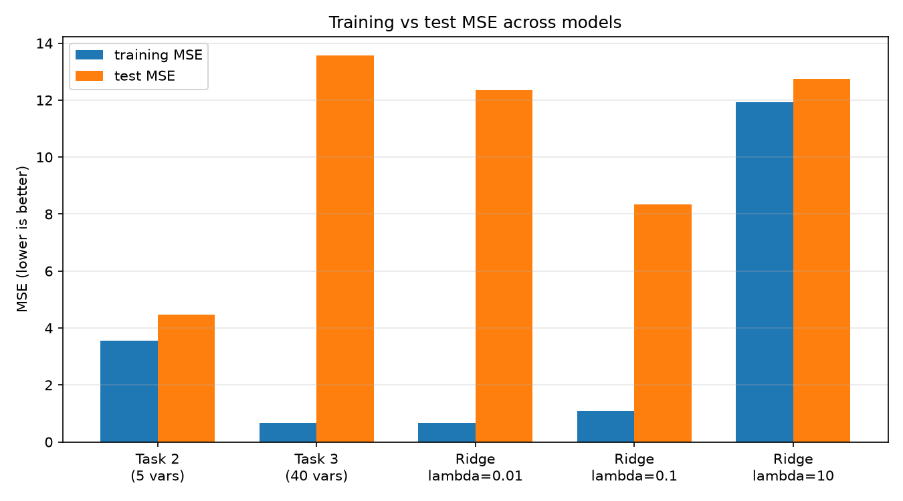

> **Fit, Fail, Fix** · Post 4 of 5
>
> *How 40 features beat 5 on the practice paper — and lost badly on the real test*

## The experiment

We repeat the exact same fitting procedure from Post 3, but this time we hand the model **all 40 features** instead of just the 5 that matter. The model now has 41 parameters (40 weights + bias) and only 56 training examples to learn them from.

Here is what happened:

| Model | Training MSE | Test MSE |
| --- | --- | --- |
| Compact — 5 features | 3.554 | **4.463** |
| Full — 40 features | **0.667** | 13.559 |

Read that again. The big model is **five times better** on the training data and **three times worse** on the test data.

## What went wrong?

Think of parameters as **knobs** you can turn to fit the training data.

- With 6 knobs (compact model), you can only make broad adjustments. You are forced to capture the main pattern — the real signal.
- With 41 knobs and only 56 rows, you can turn a knob for almost every training example. You can fit not only the signal but also the **random noise** in each row.

But the noise is random — it is different in the test set. So all that careful noise-fitting is worthless on new data. The model memorised the practice paper instead of learning the subject.

We can see the damage in the parameters: the 35 decoy features, whose true weights are zero, received non-zero estimates (several around 0.3–0.7). The model invented explanations for randomness. Its overall parameter norm grew to ‖θ‖₂ = 5.01.

## The bias–variance idea (the useful mental model)

- **Bias** = error from being too simple to capture the real pattern. The compact model has slightly higher bias.
- **Variance** = error from being too sensitive to the particular training sample. The full model has huge variance.
- Total error is roughly a trade-off between the two. Too few parameters → high bias. Too many → high variance. We want the sweet spot.

The full model drove bias down (great training fit) but variance sky-high (terrible test fit). The compact model sat near the sweet spot.

## How to spot overfitting in the wild

You do not need to see inside the model. Just watch both curves:

- Training error keeps falling ✅
- Test error stops falling and starts rising ❌

That gap between training and test performance is the fingerprint. In this lab the gap is enormous: 0.67 vs 13.56. The plot below shows it clearly.

*Training versus test MSE across the models. The 40-feature model wins on the practice paper and loses badly on the real exam; the ridge models show the fix covered in Post 5.*

## A subtle but important point

The full model did not become "stupid" — it became *over-flexible*. Its training MSE of 0.67 is genuinely impressive. The problem is that flexibility was spent on the wrong things. This is why we never judge a model by training error alone, and why we always hold out a test set (or use cross-validation).

## So what can we do?

Two obvious options:

1. **Use fewer features** — if you know which ones matter, this is great (it won here). But in real problems you usually do not.
2. **Keep the features but constrain the weights** — stop any one weight from getting too large. That is **ridge regularisation**, next post.

---

*Previous: [Post 3 — Linear Regression From Scratch](/fit-fail-fix-linear-regression-from-scratch/) · Next: [Post 5 — Ridge Regularisation](/fit-fail-fix-ridge-regularisation/).*
